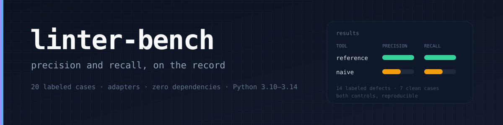
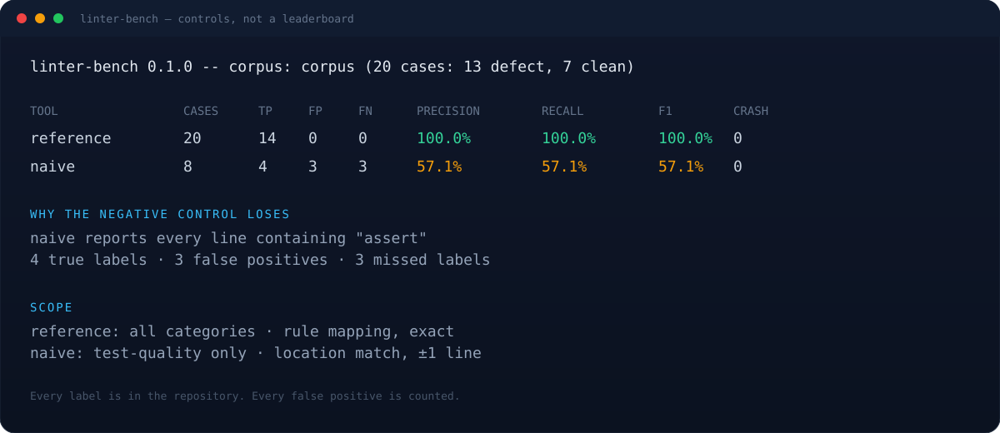

<p align="center">
  
</p>

<p align="center">
  <a href="https://github.com/muguang1224/linter-bench/actions/workflows/ci.yml"></a>
  
  
  <a href="LICENSE"></a>
</p>

**A linter that only reports recall is telling half a story.** `linter-bench` is a small, inspectable benchmark: 20 tiny Python cases with line-level labels, a tool-agnostic runner, and one scoring rule. Every false positive costs precision; every unmatched label costs recall. Both are in the output.

The point is not to crown a winner. It is to make the trade-off visible.

<p align="center">
  
</p>

## Quick start

```bash
git clone https://github.com/muguang1224/linter-bench
cd linter-bench

python3 linter_bench.py --validate
python3 linter_bench.py --tools tools.controls.json
```

The two bundled tools are **controls**, not leaderboard entrants:

- `reference` is a deliberately straightforward AST detector that implements the 14 labels. It scores 100% by construction; it exists to prove the harness works.
- `naive` flags every line containing `assert`. It scores lower and demonstrates that the benchmark can detect bad precision.

Real tools are configured in `tools.example.json`: ruff, semgrep, bandit, weak-assert, test-blindspot. They are **not installed** by this repository.

## What is in the corpus

| Category | Cases | Defect | Clean | Labels |
|----------|------:|-------:|------:|-------:|
| test-quality | 8 | 7 | 1 | 7 |
| dead-code | 4 | 2 | 2 | 2 |
| error-handling | 4 | 2 | 2 | 2 |
| security | 4 | 2 | 2 | 3 |
| **total** | **20** | **13** | **7** | **14** |

Each case is a directory with a `case.json` and ordinary source files:

```json
{
  "id": "tq-no-assert",
  "category": "test-quality",
  "defect": true,
  "description": "A test calls production code but never asserts anything.",
  "labels": [
    {"file": "tests/test_calc.py", "line": 3, "rule": "test.no-assert"}
  ]
}
```

Labels are public. That is intentional: a benchmark whose ground truth cannot be inspected is not evidence.

## Scoring

A finding matches a label when the file is the same and the line is within `--line-tolerance` (default 1). If a tool sets `"match": "rule"`, the rule must also match after applying its `rules` mapping. Matching is a maximum bipartite matching, so label order cannot change the score.

- `TP` = matched labels
- `FP` = findings that matched nothing
- `FN` = labels that matched nothing
- `precision = TP / (TP + FP)`
- `recall = TP / (TP + FN)`
- `F1 = 2PR / (P + R)`

Crashes, timeouts, adapter errors, and non-allowed exit codes are reported separately; a crashed case contributes all its labels as FN and its parsed findings as FP. `unknown` does not exist here: if a tool cannot run, that is a crash, not a missing measurement.

### Scope

Tools declare categories (`["*"]` or a subset). Metrics are computed only over cases in that scope, so a security tool is not punished for missing test-quality labels. A tool can also ignore rules or paths it explicitly does not target:

```json
{
  "name": "bandit",
  "command": ["bandit", "-q", "-r", ".", "-f", "json"],
  "adapter": "bandit",
  "categories": ["security", "error-handling"],
  "ignore_paths": ["tests/*"],
  "ignore_rules": ["B101", "B404", "B603", "B607"]
}
```

Ignore lists are part of the tool's declared scope, and they are printed in the report (`--list`). They are not hidden.

## Fairness mechanics

- **Staging.** Every case is copied to a temporary directory without `case.json`; the tool runs there and `{case}` points there. A tool cannot read the answer key or the case id from its working directory.
- **No network, no install.** The harness runs exactly the command in the config. It does not install tools or fetch rules.
- **Path normalization.** Relative, absolute, `file://`, and percent-encoded paths are normalized to the staged case root.
- **Adapters.** `json`, `sarif`, `text`, `ruff`, `semgrep`, `bandit`. Adapter failures are case errors, not tracebacks that kill the run.
- **Crash handling.** A non-allowed exit code is a crash; the report continues and lists it.

## Adding a tool

Copy `tools.example.json`, change the command and adapter, run:

```bash
python3 linter_bench.py --tools my-tools.json --only my-tool
```

Tool config fields: `name`, `command` (list, `{python}` / `{case}` / `{corpus}` / `{bench}` placeholders), `adapter`, `categories`, `match` (`location` or `rule`), `rules` (raw code → canonical rule), `timeout`, `stream` (`stdout` / `stderr` / `both`), `ok_exit_codes`, `ignore_rules`, `ignore_paths`, `env`.

## Adding a case

Create `corpus/<id>/case.json` and source files; put labels at the line a tool would naturally report (definition, assertion, `except`, call). Clean cases must be clean under **all** rules in the corpus, not just one. Then:

```bash
python3 linter_bench.py --validate
```

`--validate` checks that every label file exists, the line is in range and non-blank, ids are unique, and `defect` agrees with the presence of labels.

## Limitations

- 20 cases is a smoke test, not a survey. Do not generalize a 2-point difference.
- One language (Python), one line-based matching model. A finding on a different but semantically related line counts as FP.
- Labels are opinions. They are written down and reviewable, not objective truth.
- `--line-tolerance 1` is a deliberate compromise; two tools can be compared only under the same tolerance.
- The reference detector is a control, not a baseline for real linters.
- The harness trusts the tool command. Do not run an untrusted `tools.json`.
- Tool versions matter. The report records durations and crash counts, not versions; pin them in CI yourself.

## Output

Human table by default, `--json` for machine consumption, `--markdown` for a README leaderboard:

```bash
python3 linter_bench.py --tools tools.controls.json --json
python3 linter_bench.py --tools tools.controls.json --markdown
```

Exit codes: `0` report, `1` `--fail-under-recall` / `--fail-under-precision` missed (or invalid corpus), `2` configuration/tool error.

## Tests

```bash
python3 -m unittest discover -s tests -v
```

102 tests cover corpus validation, maximum matching, all adapters, malformed output, staging, crash/timeout handling, scope, thresholds, and JSON/Markdown stability. The reference and naive controls are exercised in CI.

## Layout

```
linter_bench.py            harness + CLI
reference_detector.py      positive control (not a product)
naive_detector.py          negative control (not a product)
corpus/                    20 labeled cases
tests/                     unittest suite
tools.reference.json       default control
tools.controls.json        positive + negative controls
tools.example.json         real-tool templates
assets/                    banner and example output
```

## 中文简介

`linter-bench` 是一个小型、可检查的静态检查器基准：20 个微型 Python 案例（13 个缺陷、7 个干净），每个缺陷标到文件与行号；运行任意 linter，按“命中标签 / 多报 / 漏报”算 precision、recall、F1，并单独统计崩溃与超时。它不宣称给所有 linter 排名，只把取舍摆出来：多报会掉 precision，漏报会掉 recall。工具在去掉 `case.json` 的临时副本里运行，读不到答案；类别与 ignore 规则必须在配置里显式声明。仓库自带的 `reference` 是正对照，`naive` 是负对照，都不是产品。

## License

MIT
